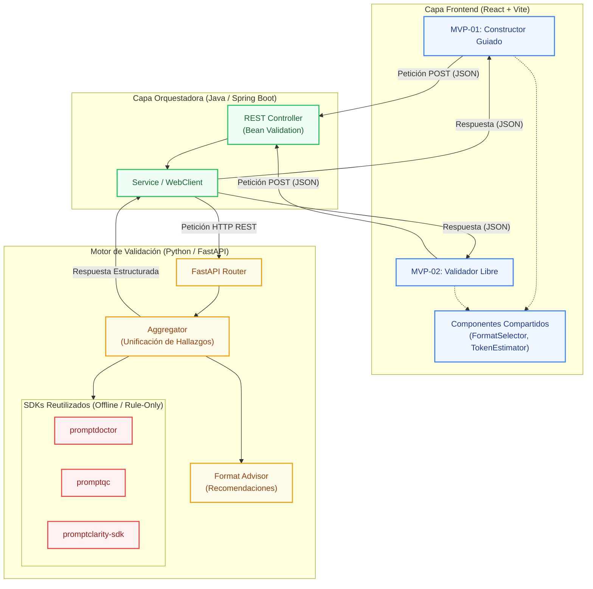

# 📘 Prompt Evaluator MVP — Documento Maestro

## Tabla de Contenidos

1. [Visión General](#1-visión-general)
2. [Arquitectura Compartida (Alto Nivel)](#2-arquitectura-compartida-alto-nivel)
3. [SDKs y Librerías Reutilizadas](#3-sdks-y-librerías-reutilizadas)
4. [Selección Inteligente de Formato](#4-selección-inteligente-de-formato-transversal-a-ambos-mvp)
5. [Estructura de Repositorio Propuesta](#5-estructura-de-repositorio-propuesta)
6. [Referencias a Documentos de Detalle](#6-referencias-a-documentos-de-detalle)
7. [Glosario](#7-glosario)
8. [Registro de Cambios](#8-registro-de-cambios)

---

## 1. Visión General

El objetivo del proyecto es construir una aplicación que **evalúe la estructura y calidad de un prompt antes de su ejecución contra un modelo de lenguaje**. El MVP no ejecuta el prompt; su valor está en actuar como un *quality gate* estático, rápido y determinista, que detecta anti-patrones, contradicciones, ambigüedades, fugas de tokens y problemas de formato antes de que el prompt llegue a producción.

La aplicación se compone de dos experiencias de usuario complementarias que comparten el mismo backend y el mismo motor de validación en Python:

| Proyecto | Enfoque | Público objetivo |
|---|---|---|
| **MVP-01 — Constructor Guiado** | El usuario rellena un formulario estructurado (rol, tarea, contexto, restricciones, formato) y el sistema ensambla el prompt, lo valida y le guía en la selección del formato de salida. | Personas que están creando un prompt desde cero y necesitan estructura y buenas prácticas. |
| **MVP-02 — Validador Libre** | El usuario pega un prompt ya redactado y obtiene un diagnóstico completo de su calidad, con un informe de hallazgos y recomendaciones de formato. | Equipos que ya tienen prompts en producción o heredados y quieren auditarlos antes de desplegarlos. |

Ambos proyectos están diseñados para ser **extensibles a una Fase 2 de ejecución**, donde se añadiría la llamada real al LLM y la validación de comportamiento (contract testing), sin necesidad de rediseñar la arquitectura.

### 1.1 Principios de Diseño

- **No ejecución en el MVP:** Ninguna de las dos experiencias llama a un modelo de lenguaje. La validación es estática, determinista y sin coste por tokens.
- **Reutilización de SDKs maduros:** La lógica de linting y scoring se delega a librerías de Python ya mantenidas por la comunidad (`promptdoctor`, `promptqc`, `promptclarity-sdk`), en lugar de reimplementar reglas desde cero.
- **Decisión informada del formato:** El usuario elige el formato del prompt con leyendas claras sobre ventajas, escenarios y precauciones, respaldadas por la evidencia disponible.
- **Separación de responsabilidades por stack:** React para la UI, Java para el contrato de API y la orquestación, Python para el motor de validación especializado.

---

## 2. Arquitectura Compartida (Alto Nivel)



**Decisión de diseño clave:** La lógica de validación reside en Python porque es el ecosistema donde existen librerías maduras y mantenidas para esta tarea (`promptdoctor`, `promptqc`, `promptclarity-sdk`). Java actúa como capa de contrato de API y orquestación, aprovechando Bean Validation para garantizar la integridad del JSON de entrada y dejando la puerta abierta a los Guardrails de LangChain4j para la Fase 2 de ejecución.

### 2.1 Flujo de Datos

1. El usuario interactúa con la UI de React (formulario o área de texto).
2. React envía una petición `POST` al backend Java con el contrato definido en cada MVP.
3. Java valida el contrato con Bean Validation y reenvía la petición al microservicio Python.
4. Python ejecuta los tres SDKs de validación y agrega los hallazgos en un JSON unificado.
5. Java transforma la respuesta (si es necesario) y la devuelve a React.
6. React renderiza el informe de validación con puntuación, hallazgos y recomendación de formato.

---

## 3. SDKs y Librerías Reutilizadas

| Capa | Componente | Rol en el MVP | Modo de Ejecución |
|---|---|---|---|
| **Python** | `promptdoctor` | Linter estático sin dependencias. Detecta ausencia de formato de salida (PD101), cuantificadores vagos (PD103), prohibiciones sin alternativa (PD104), contradicciones (PD107), placeholders sin instrucción de confianza (PD105) y duplicaciones (PD110). | 100% offline, sin dependencias de runtime, sin API key. |
| **Python** | `promptqc` | Scoring de calidad por categorías (Claridad, Consistencia, Eficiencia, Seguridad, Estructura). Devuelve `quality_score`, `grade` e `issues` con severidad y línea. | Modo `--fast` (~10 ms), basado en patrones, sin descarga de modelo. |
| **Python** | `promptclarity-sdk` | Capa de validación pre-LLM con 250+ reglas deterministas: ambigüedad, constraints ausentes, scope poco claro, datos sensibles (emails, API keys) e intenciones inseguras. | Modo *rule-only* por defecto (`use_llm=False`). Sin red, sin API key. |
| **Java** | `LangChain4j Guardrails` | *(Reservado para Fase 2)* Validación de comportamiento en runtime: `PromptInjectionGuardrail`, `PIIMaskingGuardrail`, `FormatValidationGuardrail`. | No se utiliza en el MVP (implica ejecución de modelo). |
| **Java** | `Spring Boot 3 + Bean Validation` | Validación del contrato JSON de entrada y orquestación de la llamada al microservicio Python. | Java puro, sin ejecución de LLM. |

> **Nota:** La selección de estas librerías responde a un criterio de reutilización real. No se ha encontrado un SDK Java equivalente para el linting estático de prompts, por lo que la lógica especializada se concentra en la capa Python y Java cumple el rol de orquestador.

---

## 4. Selección Inteligente de Formato (Transversal a Ambos MVP)

Uno de los requisitos centrales es que el usuario pueda **elegir de forma informada el formato del prompt**, con leyendas claras sobre ventajas y escenarios de uso. Ambos MVP incluyen un componente reutilizable `FormatSelector` que presenta las siguientes opciones con su guía asociada.

### 4.1 Guía de Formatos Presentada en la UI

| Formato | Eficiencia en Tokens | Ventaja Principal | Escenario Recomendado | Precaución |
|---|---|---|---|---|
| **Texto Plano** | ✅ Máxima (baseline) | Coste mínimo, sin sobrecarga estructural. | Prompts de razonamiento complejo en modelos pequeños (<10B), o cuando el coste por token es crítico. | Puede perder legibilidad en prompts largos con muchas secciones. |
| **Markdown** | ⚠️ +15–25% sobre texto plano | Equilibrio entre estructura, legibilidad y compatibilidad entre modelos. | Prompts de sistema con múltiples secciones (rol, tarea, restricciones, formato). Es el "máximo común divisor" entre proveedores. | No es el más barato; en modelos pequeños con muchas instrucciones puede introducir ruido. |
| **JSON** | ❌ +25–40% (y hasta +55% vs Markdown) | Alta precisión para especificar la **estructura de la salida** esperada. | Cuando se necesita que el modelo devuelva datos estructurados (clasificación, extracción, function calling). | **Evitar como formato del prompt de entrada** para tareas de razonamiento en modelos pequeños: puede degradar la precisión hasta 20–30 puntos porcentuales (*structure tax*). |
| **XML** | ❌ +13–36% vs alternativa más barata | Estructura muy explícita, popular en prompts de sistema de Anthropic. | Situaciones donde se requiere un anidamiento profundo de políticas o reglas jerárquicas. | El coste extra en tokens no siempre se traduce en mejora medible de fiabilidad. |
| **YAML** | ⚠️ ~-32% vs JSON | Punto medio entre estructura explícita y eficiencia. | Configuraciones de agentes o prompts que mezclan instrucciones y datos estructurados de forma legible. | Menos ubicuo que JSON en el ecosistema de modelos; algunos proveedores lo manejan peor. |

### 4.2 Leyenda Permanente en la UI

> *"El formato es un medio, no un fin. El contenido semántico importa más que la sintaxis. Elige el formato que mejor se alinee con tu modelo objetivo y tu tarea; no existe un formato universalmente superior."*

### 4.3 Estimador Visual de Tokens

La UI incluye un **estimador visual de tokens** que compara el prompt en el formato seleccionado frente al texto plano, para que el usuario vea el coste real de la estructura que está añadiendo. Este componente (`TokenEstimator.tsx`) es compartido por ambos MVP.

### 4.4 Reglas de Recomendación (Lógica del `format_advisor.py`)

| Modelo Objetivo | Naturaleza de la Tarea | Formato Recomendado | Formato Desaconsejado |
|---|---|---|---|
| Modelo grande (GPT-4, Claude Sonnet) | Cualquiera | Markdown | — |
| Modelo grande | Extracción / clasificación | Markdown + JSON para la salida | — |
| Modelo pequeño (<10B, GPT-4o-mini, Haiku) | Razonamiento complejo | Texto plano o Markdown ligero | JSON, XML |
| Modelo pequeño | Extracción simple | Markdown + YAML para la salida | XML |
| Cualquiera | Coste por token crítico | Texto plano | JSON, XML |
| Cualquiera | Anidamiento profundo de reglas | XML | — |

---

## 5. Estructura de Repositorio Propuesta

```text
prompt-evaluator-mvp/
├── README.md                          # Este documento maestro
├── docs/
│   ├── MVP-01-constructor-guiado.md   # Detalle técnico del Constructor Guiado
│   └── MVP-02-validador-libre.md      # Detalle técnico del Validador Libre
├── docker-compose.yml                 # Orquestación de los tres servicios
├── frontend/                          # React 18 + Vite + TypeScript
│   ├── src/
│   │   ├── components/
│   │   │   ├── shared/
│   │   │   │   ├── FormatSelector.tsx      # Selector de formato con leyendas
│   │   │   │   ├── TokenEstimator.tsx      # Comparador visual de tokens
│   │   │   │   └── ValidationReport.tsx    # Panel de hallazgos reutilizable
│   │   │   ├── builder/                   # Componentes del MVP-01
│   │   │   └── free-validator/            # Componentes del MVP-02
│   │   ├── pages/
│   │   │   ├── BuilderPage.tsx            # Ruta /builder (MVP-01)
│   │   │   └── FreeValidatorPage.tsx      # Ruta /validator (MVP-02)
│   │   ├── services/
│   │   │   └── api.ts                     # Cliente HTTP hacia Spring Boot
│   │   └── types/
│   │       └── validation.ts              # Tipos compartidos de request/response
│   ├── package.json
│   └── vite.config.ts
├── backend-java/                      # Spring Boot 3 (API Gateway)
│   ├── src/main/java/com/example/promptevaluator/
│   │   ├── controller/
│   │   │   └── PromptValidationController.java
│   │   ├── service/
│   │   │   └── PythonValidatorService.java   # Cliente del microservicio Python
│   │   ├── dto/
│   │   │   ├── ValidationRequest.java        # @NotBlank, @Size(max=…)
│   │   │   └── ValidationResponse.java
│   │   └── config/
│   │       └── WebClientConfig.java
│   └── pom.xml
└── validator-python/                  # FastAPI + SDKs de validación
    ├── app/
    │   ├── main.py                    # Endpoints /validate/builder y /validate/free
    │   ├── aggregator.py              # Unifica salidas de promptdoctor/promptqc/promptclarity
    │   ├── format_advisor.py          # Lógica de recomendación de formato
    │   └── models.py                  # Pydantic models de request/response
    ├── requirements.txt               # promptdoctor, promptqc, promptclarity-sdk
    └── Dockerfile
```

### 5.1 Convenciones de Nomenclatura

- **Frontend:** Componentes en `PascalCase.tsx`, hooks en `camelCase.ts` con prefijo `use`, tipos en `camelCase.ts` dentro de `types/`.
- **Backend Java:** Paquetes en minúsculas, clases en `PascalCase`, DTOs con sufijo `Request`/`Response`.
- **Python:** Módulos en `snake_case.py`, funciones en `snake_case`, clases Pydantic en `PascalCase`.

---

## 6. Referencias a Documentos de Detalle y Documentación Técnica

El proyecto cuenta con documentación específica dividida en dos grandes áreas: la arquitectura funcional de los MVP y la guía técnica de cada microservicio.

### 6.1 Documentos de Arquitectura y MVP (Carpeta `docs/`)

| Documento | Ruta | Contenido |
|---|---|---|
| **Maestro** | `README.md` | *(Este documento)* Visión general, arquitectura compartida, guía de formatos, estructura de repositorio. |
| **MVP-01** | [`docs/MVP-01-constructor-guiado.md`](docs/MVP-01-constructor-guiado.md) | Detalle funcional del Constructor Guiado: formulario, ensamblado, contrato de API. |
| **MVP-02** | [`docs/MVP-02-validador-libre.md`](docs/MVP-02-validador-libre.md) | Detalle funcional del Validador Libre: pegado de prompt, detección heurística, auditoría. |

### 6.2 Documentación Técnica por Microservicio

Cada carpeta principal del código fuente cuenta con su propio `README.md` con instrucciones de despliegue, variables de entorno y arquitectura interna.

| Microservicio | Ruta | Contenido |
|---|---|---|
| **Frontend** | [`frontend/README.md`](frontend/README.md) | Detalles de la UI en React, Tailwind, estructura de componentes y configuración de Vite/Nginx. |
| **Backend (Gateway)** | [`backend-java/README.md`](backend-java/README.md) | Detalles del API Gateway, Spring Boot, WebClient, CORS y validación de contratos. |
| **Motor de Validación** | [`validator-python/README.md`](validator-python/README.md) | Detalles de FastAPI, los SDKs (promptdoctor, etc.), y la lógica del agregador/fallback. |

Ambos documentos de arquitectura **referencian explícitamente este documento maestro** para la guía de formatos (sección 4) y la arquitectura compartida (sección 2), evitando duplicación de información y garantizando que cualquier cambio se aplique de forma coherente.

---

## 7. Glosario

| Término | Definición |
|---|---|
| **Prompt** | Instrucción en lenguaje natural (o estructurado) enviada a un modelo de lenguaje para obtener una respuesta. |
| **Quality Gate** | Punto de control que un artefacto (en este caso, un prompt) debe superar antes de avanzar a la siguiente fase del ciclo de vida. |
| **Structure Tax** | Fenómeno por el cual imponer un formato estructurado (JSON, XML) a un modelo pequeño degrada su capacidad de razonamiento. |
| **Contract Testing** | Validación de que la salida de un prompt cumple un contrato predefinido (esquema JSON, campos requeridos, enums). |
| **Few-shot** | Técnica de prompting que incluye ejemplos de entrada/salida para guiar al modelo. |
| **Rule-only mode** | Modo de ejecución de un SDK de validación que utiliza únicamente reglas deterministas, sin llamar a un LLM. |
| **Máximo Común Divisor (de formatos)** | Formato que ofrece el mejor equilibrio entre compatibilidad, estructura y coste para la mayoría de modelos y tareas. En este proyecto, Markdown. |

---

## 8. Registro de Cambios

| Versión | Fecha | Autor | Cambio |
|---|---|---|---|
| 1.1.0 | 2026-11-08 | David Yurivilca | Actualización del diagrama de arquitectura a Mermaid para mejor renderizado y visualización. |
| 1.0.0 | 2026-11-08 | David Yurivilca | Versión inicial del documento maestro. Define visión, arquitectura, SDKs, guía de formatos y estructura de repositorio. |

---

*Fin del documento maestro. Para detalles de implementación de cada MVP, consultar los documentos referenciados en la sección 6.*